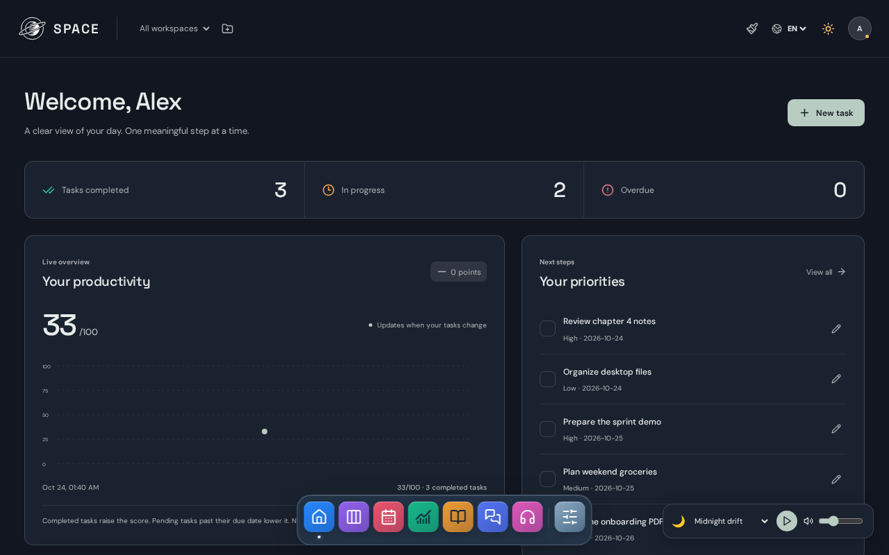

# SPACE Tasks

[](https://github.com/nelsonvis3/space-tasks/actions/workflows/quality.yml)

A free, open-source productivity app: tasks, calendar, a PDF reader and music. Its AI, OCR and translation run on your own device, so there are no paid APIs and nothing to track you.



- **Tasks and planning**: workspaces, priorities, calendar and progress stats.
- **PDF reader**: local OCR and translation in seven languages.
- **On-device AI assistant**: WebLLM on WebGPU; no AI provider sees your questions.
- **Private accounts**: password-protected, with version history, recovery and automatic backups, all on your computer.

**Engineering highlights:** strict CSP with no CDN scripts (runtimes pinned by sha512), rate-limited auth with scrypt and CSRF protection, verified SQLite backups, and 87 unit plus Playwright tests on Chromium and Firefox, including accessibility checks.

**Stack:** React 19 · TypeScript · Vite · Node 24 (built-in SQLite) · Electron · Playwright

**Status:** early release. Try the [live demo](https://nelsonvis3.github.io/space-tasks/) in your browser (data stays on your device), or run the complete desktop app on Linux as an AppImage.

## Desktop app (Linux)

Download `SPACE_Tasks-3.0.1-x86_64.AppImage` from the [latest release](https://github.com/nelsonvis3/space-tasks/releases/latest), make it executable and open it:

```bash
chmod +x SPACE_Tasks-3.0.1-x86_64.AppImage
./SPACE_Tasks-3.0.1-x86_64.AppImage
```

Your accounts, PDF library and backups stay in `~/.config/SPACE Tasks`. Translation, OCR and the assistant download their models the first time you use them.

## Run it

```bash
npm run runtime:install          # pinned Node 24 for this project
npm run runtime -- run dev       # app and API at http://localhost:5173
npm run runtime -- run verify    # types, tests and build
npm run runtime -- run desktop   # desktop window (after a build)
npm run runtime -- run appimage  # Linux AppImage in release/ (after a build)
```

## License

Code under [GPL-3.0-only](LICENSE). The logo is © Nelson Sivisstum, all rights reserved; see [LICENSING.md](LICENSING.md).

Built by [Nelson Sivisstum](https://nelsonsivisstum.vercel.app/).
